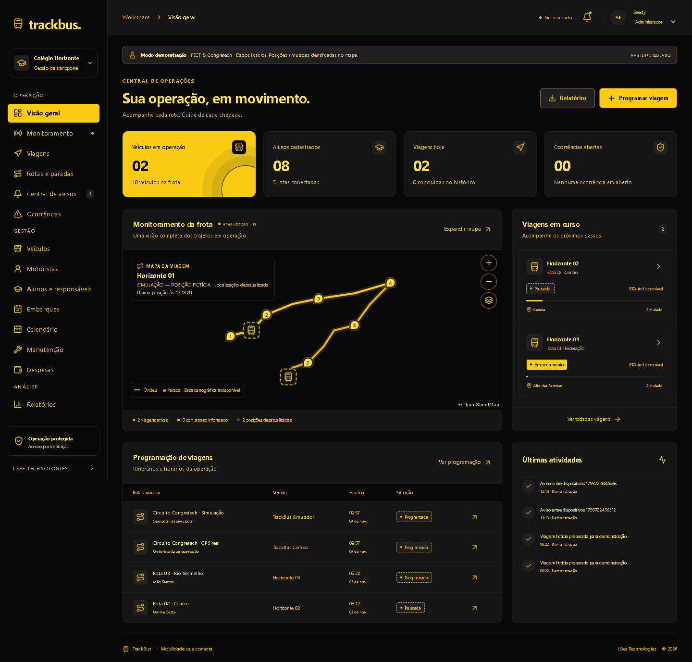
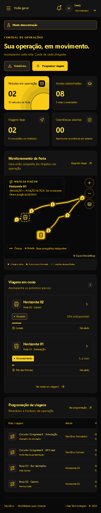
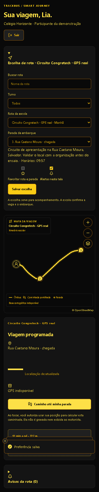

# TrackBus — Mobilidade Escolar Inteligente

Plataforma integrada de gestão, rastreamento e acompanhamento de transporte escolar desenvolvida pela **I.See Technologies** para demonstração técnica na **FECT** e **Congretech**.

O **TrackBus** combina uma aplicação web full-stack (React 19, Vite/Vinext, Hono e Cloudflare Workers + D1), um motor local determinístico de roteamento viário sobre dados reais do OpenStreetMap de Salvador (`packages/geodata`), o portal **Smart Journey** para alunos e visitantes da feira, e o aplicativo nativo Android **TrackBus Driver** (React Native / Expo) com transmissão de GPS em segundo plano.

> **Aviso de escopo e homologação:** Este repositório contém dados iniciais estritamente fictícios voltados para demonstração acadêmica e técnica (FECT / Congretech). A operação em produção real com transporte de menores exige homologação institucional, contratação de provedor geográfico com SLA, revisão jurídica/LGPD e auditoria independente de segurança.

---

## Identidade Visual e Interface

O sistema adota exclusivamente a identidade visual **preto e amarelo de alto contraste** (`#090909`, `#141414`, `#202020`, `#FACC15`, `#EAB308`, `#FDE047`, `#A16207`), garantindo legibilidade em campo, acessibilidade por formas/padrões de borda além da cor e suporte a desktop e dispositivos móveis.

| Painel Operacional (Desktop) | Operação Responsiva (Mobile) | Smart Journey (Aluno / Feira) |
| :---: | :---: | :---: |
|  |  |  |

---

## Principais Funcionalidades

- **Gestão Operacional Multi-Instituição (`org_id`)**: Cadastro persistente de veículos, motoristas, alunos, vínculos verificados de responsáveis, calendário letivo, manutenção preventiva/corretiva, despesas operacionais, relatórios com exportação CSV e trilha de auditoria.
- **Editor de Rotas e Versionamento Imutável**: Criação visual de paradas no mapa MapLibre GL, reordenação, publicação seletiva no catálogo de alunos e cálculo de traçado sobre vias reais (motor local OSM de Salvador ou adaptador HTTPS Valhalla). Viagens criadas preservam o snapshot imutável da versão da rota.
- **Programação e Máquina de Estados de Viagens**: Prevenção de conflitos de escala (veículo/motorista) via triggers SQLite no D1, validação de capacidade e calendário, controle de concorrência otimista (`revision`) e transições estritas (`scheduled` → `in_progress` ⇄ `paused` / `interrupted` → `completed` / `cancelled`).
- **Rastreamento GPS Real e Simulador Identificado**: Separação estrita no banco (`tracking_mode: "gps" | "simulation"`) entre viagens operadas por GPS físico e viagens de simulação demonstrativa (sempre rotuladas como `SIMULAÇÃO — POSIÇÃO FICTÍCIA`). Validação de precisão, janela temporal, frequência e velocidade plausível.
- **Smart Journey (ETA + Caminhada + Recomendação de Saída)**: Entrada demonstrativa simplificada por nome/apelido restrita à sala aberta da feira (`/participar`), seleção de rota/parada favorita, cálculo de ETA em faixa de minutos (`minMinutes`–`maxMinutes`), rota de caminhada pelas ruas mapeadas sem persistir a localização do aluno e recomendação de horário de saída com margem de segurança configurável.
- **Avisos, Ocorrências, Espera Autorizada e Web Push**: Comunicação de atrasos, panes mecânicas (com abertura automática de ocorrência e bloqueio de retomada até resolução), espera autorizada na parada (com reconciliação transacional automática de expiração) e notificações Web Push VAPID (RFC 8291/8292) sem dados pessoais no payload.
- **Aplicativo Android `TrackBus Driver`**: App React Native / Expo com pareamento por código de uso único de 16 caracteres (validade de 2 minutos), armazenamento em `SecureStore` (Keystore/Keychain), serviço em primeiro plano (`foregroundService`) para GPS em segundo plano, fila de reenvio da última posição e trava de segurança exigindo confirmação de veículo parado.

---

## Arquitetura do Repositório

```text
trackbus/
├── apps/
│   ├── api/            # Backend Hono (Cloudflare Workers), RBAC, sessões, Smart Journey, Push VAPID e Valhalla
│   ├── web/            # Frontend React 19, MapLibre GL, Smart Journey, Portal do Responsável e Painel Admin
│   └── driver/         # Aplicativo Android nativo (Expo / React Native) com GPS em segundo plano
├── packages/
│   ├── domain/         # Máquina de estados, geometria esférica, projeção linear, validação GPS, ETA e saída
│   ├── geodata/        # Grafo viário offline de Salvador (OpenStreetMap ODbL) e motor de busca A*
│   ├── validation/     # Schemas Zod estritos (.strict()) compartilhados com a API
│   └── shared/         # Contratos TypeScript do estado operacional
├── db/                 # Schema Drizzle ORM (SQLite / Cloudflare D1)
├── drizzle/            # Migrações SQL versionadas (0000 a 0003) e triggers de integridade
├── worker/             # Entrypoint Cloudflare Worker principal e Event Gateway público para participantes
├── app/                # Shell Next/Vinext e rota de integração da API
├── public/             # Manifesto PWA, Service Worker, ícones e página offline
├── scripts/            # Automação de build de assets, migração D1 local e varredura estática de segurança
├── tests/              # Testes unitários (Vitest), integração (Miniflare/D1 real) e E2E (Playwright)
└── docs/               # Documentação técnica completa de engenharia de software
```

---

## Requisitos e Execução Local

### Pré-requisitos

- **Node.js** `>= 22.13.0` (recomendado Node.js 24 LTS)
- **npm** e **Git**
- **Microsoft Edge** (no Windows) ou Chromium instalado para execução dos testes E2E com Playwright

### 1. Instalar dependências e preparar banco local

```sh
npm run install:ci
npm run build
npm run db:migrate:local
```

### 2. Iniciar o servidor de desenvolvimento

```sh
npm run dev -- --port 5173
```

Acesse `http://127.0.0.1:5173`:

- **Painel Completo (Admin / Motorista / Aluno / Responsável / Monitor)**: Clique em **Abrir demonstração** para inicializar a instituição fictícia (*Colégio Horizonte*) e utilize o seletor **Perfil de demonstração** no topo direito para alternar entre perfis.
- **Entrada Demonstrativa de Alunos (Feira)**: Acesse `http://127.0.0.1:5173/#/participar` (ou utilize o formulário da tela inicial quando a sala Smart Journey estiver aberta).

---

## Verificação de Qualidade e Testes

Execute a suíte de verificação estática, testes automatizados, auditoria de segurança e build:

```sh
npm run typecheck
npm run lint
npm test
npm run security
npm audit
npm run build
```

Para verificar o aplicativo Android (`apps/driver`):

```sh
cd apps/driver
npm run typecheck
```

Com o servidor de desenvolvimento rodando em `http://127.0.0.1:5173`, execute os testes E2E:

```sh
npm run test:e2e
```

---

## Documentação Técnica

A documentação completa do projeto está organizada no diretório [`docs/`](docs/):

- **[Arquitetura e Fluxo de Dados](docs/ARCHITECTURE.md)** (`docs/ARCHITECTURE.md`)
- **[Funcionalidades Implementadas e Planejadas](docs/FEATURES.md)** (`docs/FEATURES.md`)
- **[Segurança, Controles e Limitações](docs/SECURITY.md)** (`docs/SECURITY.md`)
- **[Banco de Dados D1, Modelo e Migrações](docs/DATABASE.md)** (`docs/DATABASE.md`)
- **[Referência da API e Autorização](docs/API.md)** (`docs/API.md`)
- **[Rastreamento GPS e Integração entre Dispositivos](docs/GPS.md)** (`docs/GPS.md`)
- **[Smart Journey: Cálculo de Chegada e Caminhada](docs/SMART_JOURNEY.md)** (`docs/SMART_JOURNEY.md`)
- **[Aplicativo Android TrackBus Driver](docs/DRIVER.md)** (`docs/DRIVER.md`)
- **[Implantação e Hospedagem Cloudflare](docs/DEPLOYMENT.md)** (`docs/DEPLOYMENT.md`)
- **[Roteiro de Demonstração — FECT e Congretech](docs/DEMO.md)** (`docs/DEMO.md`)
- **[Testes Executados e Resultados](docs/TESTING.md)** (`docs/TESTING.md`)

### Documentos Complementares de Referência

- [Operação e Contingência](docs/OPERACAO.md) (`docs/OPERACAO.md`)
- [Evidências de Qualidade](docs/QUALIDADE.md) (`docs/QUALIDADE.md`)
- [Decisões Arquiteturais (ADR)](docs/architecture/DECISIONS.md) (`docs/architecture/DECISIONS.md`)
- [Modelo de Ameaças](docs/security/THREATS.md) (`docs/security/THREATS.md`)
- [Malha Viária Demonstrativa de Salvador (OSM)](docs/geodata/SALVADOR.md) (`docs/geodata/SALVADOR.md`)

---

## Licença e Créditos de Terceiros

- **TrackBus**: Desenvolvido por **I.See Technologies** (2026).
- **Dados Cartográficos e Malha Viária Local**: © [OpenStreetMap contributors](https://www.openstreetmap.org/copyright), disponibilizados sob licença [ODbL 1.0](https://opendatacommons.org/licenses/odbl/1-0/).
- **Bibliotecas Open Source**: React, Hono, Drizzle ORM, MapLibre GL, Zod, TanStack Query, Radix UI, Lucide Icons, Recharts, Tailwind CSS, Expo / React Native, Vitest e Playwright (ver `package.json` e `vendor/`).
