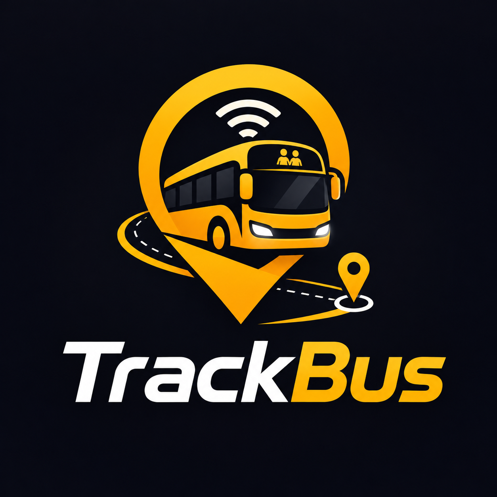
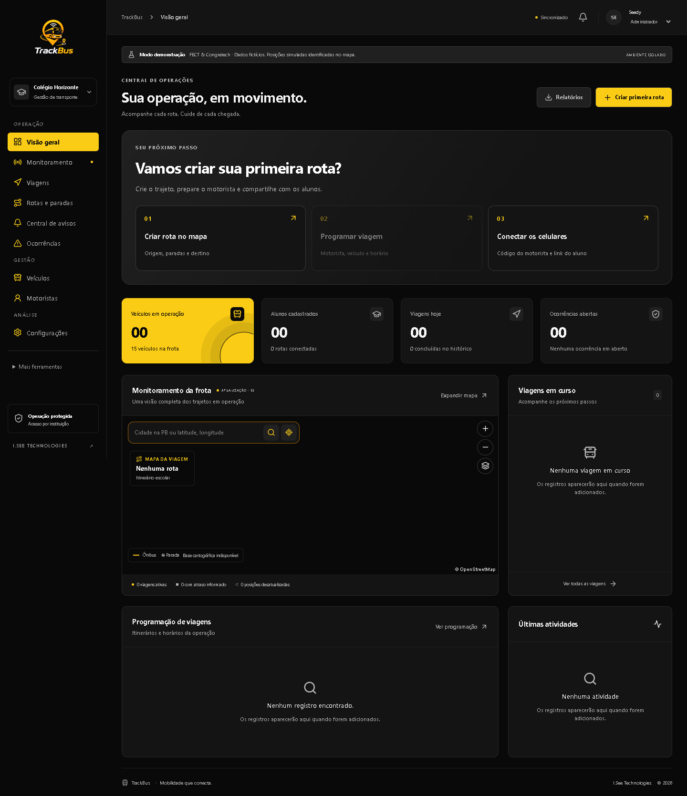
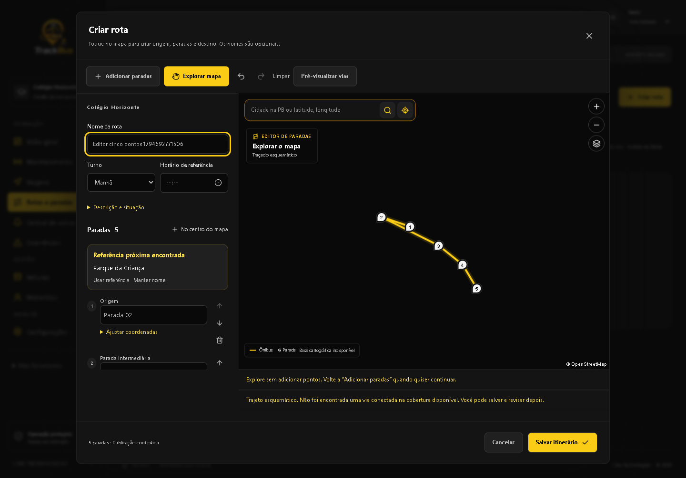
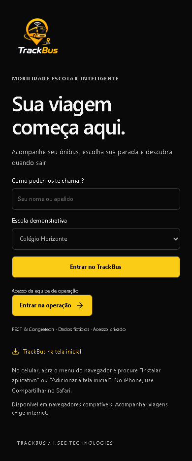

<p align="center"></p>

# TrackBus — Mobilidade Escolar Inteligente

Plataforma de transporte escolar da **I.See Technologies**, preparada para demonstração técnica na **FECT e Congretech, em Campina Grande/PB**. Gestão cria rotas no mapa; alunos da mesma escola escolhem rota e parada; Smart Journey combina posição do ônibus, caminhada, estimativas e avisos.

Esta atualização preserva o projeto e o histórico anteriores. [Demonstração no Cloudflare](https://trackbus-demonstracao.goldensla6.workers.dev) · [Entrada administrativa protegida](https://trackbus-demonstracao.goldensla6.workers.dev/entrar). Estado de publicação em [Cloudflare](docs/CLOUDFLARE.md); auditoria e evidências em [V11](docs/V11-AUDITORIA.md). Há somente três perfis ativos: aluno, motorista e administrador. A apresentação começa sem rotas, para criação ao vivo. Não foi realizado push ao GitHub nesta etapa.

## V11 — preparação para 30/11 e 01/12/2026

- Google Maps, Places New e Routes integrados por adaptador: pesquisa mundial, estabelecimentos, mapa e cálculo viário. Demo Key limitada a desenvolvimento/avaliação, bloqueada em produção. **Aguardam chave local e validação real**; nenhuma cobrança foi ativada. [APIs e variáveis](docs/GOOGLE_MAPS.md).
- Editor existente preservado e ampliado com desenho livre, simplificação, desfazer/refazer e ajuste viário opcional. Desenho manual é identificado como esquemático.
- [Voltas separadas](docs/TRIP_CYCLES.md), histórico, proteção contra repetição e fim da janela operacional. Nova volta exige confirmação segura, sem reinício por um único GPS.
- [Confirmação de espera](docs/STUDENT_CHECKINS.md), cancelamento, expiração de 15 minutos e somente contagens para o motorista.
- [Web Push](docs/WEB_PUSH.md) cifrado, preferências, fila durável, revogação e Cron. Smart Departure usa estimativa válida por dez minutos, sem guardar a posição do aluno. **Recebimento com página fechada ainda depende do ensaio físico**.
- APK Android **11.0.0/code10** compilado e com assinatura verificada. [Instalação e limitações](docs/DRIVER.md). GPS em segundo plano ainda não homologado em dispositivo.

## Interface

Identidade preta/amarela com branco e cinzas neutros para leitura no web, PWA e Driver. Logo oficial fornecida pelo proprietário em 10/11/2026 integrada ao fundo sem redesenho; arquivo original preservado.

| Gestão                                       | Editor por clique                              | Aluno                                                |
| -------------------------------------------- | ---------------------------------------------- | ---------------------------------------------------- |
|  |  |  |

Capturas de testes reais da aplicação local. Os E2E bloqueiam tiles externos deliberadamente; a ausência de ruas nessas capturas não é uma imagem de cartografia fictícia.

## Funcionalidades

- Cadastros persistentes de veículos, motoristas, alunos administrativos, rotas e viagens, com isolamento por instituição.
- [Editor MapLibre](docs/ROUTE_EDITOR.md) por clique e arraste, nomes automáticos, explorar/adicionar, desfazer/refazer, reordenação, prévia e publicação. GPS consentido centraliza e pode definir a origem. Versionamento preserva itinerários de viagens existentes.
- 4.707 referências nomeadas do extrato OSM da Paraíba; consultas limitadas à região do mapa e filtros por categoria. Sugestão “Próximo a…” confirmada pelo usuário, sem obrigar digitação.
- Motorista cria rascunho no editor aberto pelo Driver, envia à gestão e recebe aprovação ou pedido de ajustes. Somente o admin publica; estudante nunca vê rascunhos.
- Aluno demonstrativo entra por apelido e escola aberta. Todas as rotas publicadas da escola ficam disponíveis, sem vínculo individual obrigatório. Favoritos não confirmam vaga.
- Smart Journey mostra ônibus, parada, ETA em faixa, caminhada autorizada, margem de saída e avisos. Informações insuficientes resultam em previsão indisponível.
- Android Driver com pareamento protegido, serviço de GPS em segundo plano, buffer da última posição, controles operacionais e encerramento da transmissão.
- Avisos, leitura, atraso, pane/resolução e espera autorizada até cinco minutos. Web Push opcional e de melhor esforço.
- Simulador separado de GPS e dados fictícios. Rotas de exemplo locais arquivadas com histórico preservado; novas instalações não criam trajetos automaticamente.
- Embarques, ausências, calendário, manutenção, despesas, CSV e auditoria mantidos. Perfis antigos de responsável/monitor sem acesso nesta versão.

## Mapas e contingência existente

Com Google configurado, busca mundial por nomes parciais, locais e estabelecimentos. Até a ativação, o mapa existente mantém busca local nas **223 sedes municipais**, fonte IBGE, e navegação livre por coordenadas. Edição começa em Campina Grande. GPS e cadastro não são restritos a uma cidade. O catálogo OSM anterior foi preservado, sem expansão como substituto do Places.

Circuito demonstrativo real de **871m** no Açude Velho, com rede OSM local para ônibus/pedestre. O recorte anterior de Salvador continua disponível. Isso **não significa roteamento estadual completo**: fora dos recortes conectados é necessário provedor Valhalla institucional ou a interface informa indisponibilidade/traçado esquemático. Pontos de apresentação precisam de inspeção presencial. [Mapas](docs/MAPS.md) · [proveniência Campina/IBGE](docs/geodata/CAMPINA_GRANDE.md).

## Stack e arquitetura

React19, TypeScript strict, Vite/Vinext, React Router, TanStack Query, React Hook Form, Zod, Radix, Lucide, MapLibre e PWA. Backend Hono/Cloudflare Workers, D1 e Drizzle. Native Expo58/React Native0.88.1. Vitest, Miniflare e Playwright.

Vinext entrega shell e Worker; React Router mantém a navegação. Consultas web a cada5s em operação,15s sem viagem ativa; pausadas com aba oculta. Não há Firebase, PostgreSQL, VPS, Kubernetes nem serviços pagos obrigatórios.

```text
apps/web       Interface, mapa e Smart Journey
apps/api       API, autorização, viagens, jornada e avisos
apps/driver    Pacote nativo Expo independente
packages       Domínio, validação, tipos e geodados
db / drizzle   Modelo D1 e migrações0000..0013
worker         Worker principal e gateway opcional
tests          Unitários, integração D1 local e E2E
docs           Arquitetura, operação e evidências
```

## Execução local

Node >=22.13, npm e Git. Windows usa Edge nos E2E; Linux usa Chromium.

```sh
npm ci
npm run build
npm run db:migrate:local
npm run dev -- --host 127.0.0.1 --port 5173
```

Abrir http://127.0.0.1:5173, autenticar no modo local e usar **Configurar apresentação**. Criar/publicar a rota, programar viagem e conectar os celulares em **Configurações**. Em outro navegador acessar `/#/participar`. Login simulado de desenvolvimento não é autenticação de produção.

## Verificação

```sh
npm run typecheck
npm run lint
npm test
npm run security
npm audit
npm run test:e2e
npm run typecheck --prefix apps/driver
npm audit --prefix apps/driver
```

[Resultados e alcance](docs/TESTING.md). D1 de integração/local não é o banco remoto. CI foi atualizado, mas esta execução não comprova GitHub Actions/CodeQL remotos.

## Driver, deploy e segurança

[Instalar e compilar Driver](docs/DRIVER.md) · [Cloudflare próprio](docs/CLOUDFLARE.md) · [Sites e execução local](docs/DEPLOYMENT.md) · [segurança](docs/SECURITY.md).
APK V11 compilado, mas GPS com tela bloqueada exige ensaio físico ainda pendente. O modo Cloudflare próprio verifica JWT Access para a equipe e mantém sessões restritas de aluno/Driver. O modo Sites continua dependendo do gateway confiável. Chaves privadas jamais vão para cliente/Git; a chave pública do SDK Google exige restrições por origem/API/quota.

## Documentação

[Arquitetura](docs/ARCHITECTURE.md) · [funcionalidades e auditoria](docs/FEATURES.md) · [API](docs/API.md) · [banco](docs/DATABASE.md) · [editor](docs/ROUTE_EDITOR.md) · [localização e privacidade](docs/GEOLOCATION.md) · [GPS](docs/GPS.md) · [Smart Journey](docs/SMART_JOURNEY.md) · [notificações](docs/NOTIFICATIONS.md) · [demonstração](docs/DEMO.md) · [pendências](docs/ROADMAP.md) · [diagnóstico](docs/TROUBLESHOOTING.md).

## Créditos e licença

TrackBus, I.See Technologies. Não foi adicionada licença open-source ao produto sem autorização do proprietário.
Cartografia © [OpenStreetMap contributors](https://www.openstreetmap.org/copyright), dados sob ODbL1.0; catálogo municipal [IBGE](docs/geodata/CAMPINA_GRANDE.md). Bibliotecas mantêm suas próprias licenças, registradas nos pacotes e em vendor/. Não utilizar cadastros reais de menores na demonstração.

O mapa mantém o trecho percorrido discreto e destaca em amarelo o trajeto restante, usando somente posições confirmadas. Após 2 minutos de leituras contínuas parado junto à parada, mostra “Aguardando no ponto”. É uma indicação pelo GPS, separada da espera autorizada de cinco minutos.
