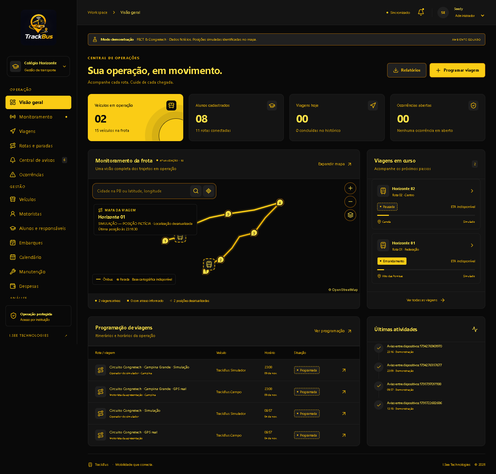
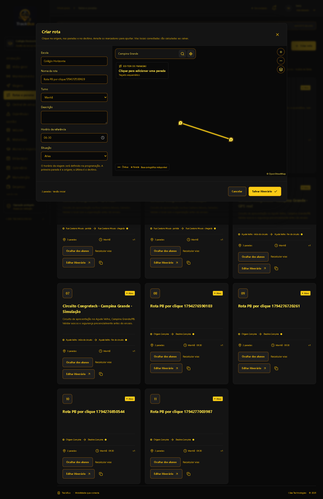
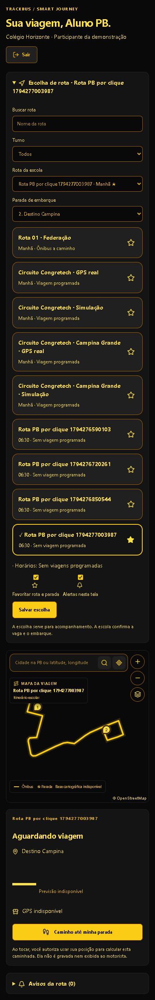

<p align="center"></p>

# TrackBus — Mobilidade Escolar Inteligente

Plataforma de transporte escolar da **I.See Technologies**, preparada para demonstração técnica na **FECT e Congretech, em Campina Grande/PB**. Gestão cria rotas no mapa; alunos da mesma escola escolhem rota e parada; Smart Journey combina posição do ônibus, caminhada, estimativas e avisos.

Esta atualização preserva o projeto e o histórico anteriores. A etapa V6.1 foi feita localmente, sem push ou publicação. Estado de verificação e pendências em [relatório V6](docs/V6-ENTREGA.md).

## Interface

Identidade preta/amarela no web, PWA e Driver. Logo oficial fornecida pelo proprietário em 10/11/2026 integrada sem redesenho; arquivo original preservado.

| Gestão                                       | Editor por clique                              | Aluno                                                |
| -------------------------------------------- | ---------------------------------------------- | ---------------------------------------------------- |
|  |  |  |

Capturas de testes reais da aplicação local. Os E2E bloqueiam tiles externos deliberadamente; a ausência de ruas nessas capturas não é uma imagem de cartografia fictícia.

## Funcionalidades

- Cadastros persistentes de veículos, motoristas, alunos administrativos, rotas e viagens, com isolamento por instituição.
- Editor MapLibre por clique e arraste, ordem/IDs de paradas, horário de referência, edição, ativação e publicação. Versionamento preserva itinerário de viagens existentes.
- Aluno demonstrativo entra por apelido e escola aberta. Todas as rotas publicadas da escola ficam disponíveis, sem vínculo individual obrigatório. Favoritos não confirmam vaga.
- Smart Journey mostra ônibus, parada, ETA em faixa, caminhada autorizada, margem de saída e avisos. Informações insuficientes resultam em previsão indisponível.
- Android Driver com pareamento protegido, serviço de GPS em segundo plano, buffer da última posição, controles operacionais e encerramento da transmissão.
- Avisos, leitura, atraso, pane/resolução e espera autorizada até cinco minutos. Web Push opcional e de melhor esforço.
- Simulador separado de GPS, circuito OSM de Campina e dados fictícios. Rotas e dados anteriores preservados.
- Embarques, ausências, responsáveis, calendário, manutenção, despesas, CSV e auditoria mantidos.

## Mapas da Paraíba

Busca local nas **223 sedes municipais**, fonte IBGE, e navegação livre por coordenadas. Edição começa em Campina Grande. GPS e cadastro não são restritos a uma cidade.

Circuito demonstrativo real de **871m** no Açude Velho, com rede OSM local para ônibus/pedestre. O recorte anterior de Salvador continua disponível. Isso **não significa roteamento estadual completo**: fora dos recortes conectados é necessário provedor Valhalla institucional ou a interface informa indisponibilidade/traçado esquemático. Pontos de apresentação precisam de inspeção presencial. [Mapas](docs/MAPS.md) · [proveniência Campina/IBGE](docs/geodata/CAMPINA_GRANDE.md).

## Stack e arquitetura

React19, TypeScript strict, Vite/Vinext, React Router, TanStack Query, React Hook Form, Zod, Radix, Lucide, MapLibre e PWA. Backend Hono/Cloudflare Workers, D1 e Drizzle. Native Expo58/React Native0.88.1. Vitest, Miniflare e Playwright.

Vinext entrega shell e Worker; React Router mantém a navegação. Consultas web a cada5s em operação,15s sem viagem ativa; pausadas com aba oculta. Não há Firebase, PostgreSQL, VPS, Kubernetes nem serviços pagos obrigatórios.

```text
apps/web       Interface, mapa e Smart Journey
apps/api       API, autorização, viagens, jornada e avisos
apps/driver    Pacote nativo Expo independente
packages       Domínio, validação, tipos e geodados
db / drizzle   Modelo D1 e migrações0000..0005
worker         Worker principal e gateway opcional
tests          Unitários, integração D1 local e E2E
docs           Arquitetura, operação e evidências
```

## Execução local

Node >=22.13, npm e Git. Windows usa Edge nos E2E; Linux usa Chromium.

```sh
npm ci
npm run build
npm run db:migrate:local
npm run dev -- --host 127.0.0.1 --port 5173
```

Abrir http://127.0.0.1:5173, autenticar no modo local e usar **Abrir demonstração**. Em **Configurações**, preparar circuitos e abrir Sala Smart Journey. Em outro navegador acessar `/#/participar`. Login simulado de desenvolvimento não é autenticação de produção.

## Verificação

```sh
npm run typecheck
npm run lint
npm test
npm run security
npm audit
npm run test:e2e
npm run typecheck --prefix apps/driver
npm audit --prefix apps/driver
```

[Resultados e alcance](docs/TESTING.md). D1 de integração/local não é o banco remoto. CI foi atualizado, mas esta execução não comprova GitHub Actions/CodeQL remotos.

## Driver, deploy e segurança

[Instalar e compilar Driver](docs/DRIVER.md) · [Cloudflare e acesso entre dispositivos](docs/DEPLOYMENT.md) · [segurança](docs/SECURITY.md).
O APK foi compilado, mas GPS com tela bloqueada exige ensaio físico ainda pendente. O Site privado exige login de gateway; acesso direto de participantes/Android requer endpoint autorizado. O Worker confia em identidade protegida pelo gateway Sites e não deve ser exposto cru a headers arbitrários. Nenhum segredo deve ir para cliente/Git.

## Documentação

[Arquitetura](docs/ARCHITECTURE.md) · [funcionalidades e auditoria](docs/FEATURES.md) · [API](docs/API.md) · [banco](docs/DATABASE.md) · [GPS](docs/GPS.md) · [Smart Journey](docs/SMART_JOURNEY.md) · [notificações](docs/NOTIFICATIONS.md) · [demonstração](docs/DEMO.md) · [pendências](docs/ROADMAP.md) · [diagnóstico](docs/TROUBLESHOOTING.md).

## Créditos e licença

TrackBus, I.See Technologies. Não foi adicionada licença open-source ao produto sem autorização do proprietário.
Cartografia © [OpenStreetMap contributors](https://www.openstreetmap.org/copyright), dados sob ODbL1.0; catálogo municipal [IBGE](docs/geodata/CAMPINA_GRANDE.md). Bibliotecas mantêm suas próprias licenças, registradas nos pacotes e em vendor/. Não utilizar cadastros reais de menores na demonstração.

O mapa mantém o trecho percorrido discreto e destaca em amarelo o trajeto restante, usando somente posições confirmadas. Após 2 minutos de leituras contínuas parado junto à parada, mostra “Aguardando no ponto”. É uma indicação pelo GPS, separada da espera autorizada de cinco minutos.
