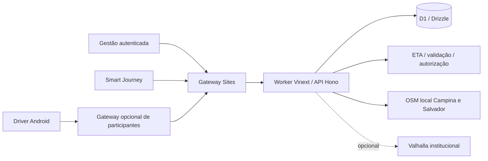

# Arquitetura TrackBus
React19/TypeScript estrito no shell Vinext/Vite existente. React Router organiza a aplicação, TanStack Query sincroniza dados, RHF e Zod validam formulários/entrada. MapLibre renderiza mapas, Drizzle/Hono atendem Cloudflare Workers+D1. Expo58/React Native cuidam do Driver.

worker/index.ts é entrypoint, app/api/[...path]/route.ts encaminha para apps/api. apps/web/App.tsx preserva módulos administrativos e portal de responsáveis; SmartJourney.tsx atende aluno/visitante. packages/domain contém funções puras, packages/validation schemas, packages/geodata malhas e catálogo IBGE. apps/driver é pacote separado para respeitar versões Expo/React.

Consulta adaptativa na web: 5s com viagem ativa, 15s quando sem execução, sem polling em aba oculta. Native limita envios a5s, guarda somente a leitura pendente recente. D1 mantém posição atual e eventos operacionais; não guarda trajetória pessoal do aluno. Não há WebSocket/Durable Object nem servidor de roteamento pesado. Avaliar filas/outbox e canais persistentes só com métricas que justifiquem custo/complexidade.

Rotas e versões são agregados JSON; viagens usam snapshot. API deriva instituição da sessão, nunca de um campo livre do formulário. Favoritos são preferências separadas de matrículas/vagas. GPS e simulação não misturam fonte na mesma viagem.

Dados OSM locais dispensam serviço externo apenas no recorte conectado; tiles e sincronização continuam exigindo internet. Cloudflare independente exige fronteira de identidade implementada; Sites privado e gateway opcional têm restrições descritas em DEPLOYMENT.md e SECURITY.md.
