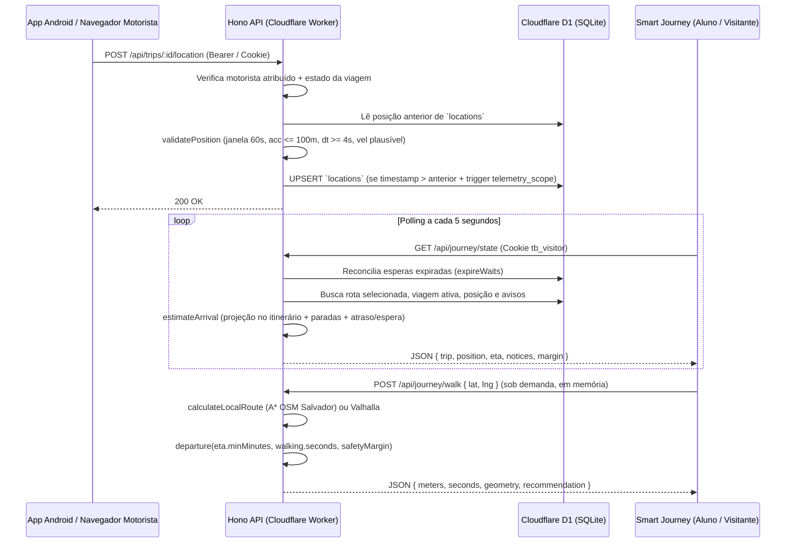

# Arquitetura e Fluxo de Dados — TrackBus

Este documento descreve a arquitetura real implementada no repositório do **TrackBus**, suas camadas, limites de confiança, escolhas tecnológicas e fluxos de dados entre os aplicativos web, backend serverless, banco D1 e aplicativo móvel Android.

---

## 1. Visão Geral da Arquitetura

O TrackBus utiliza uma arquitetura leve e serverless, projetada para operar inteiramente sobre **Cloudflare Workers** e **Cloudflare D1 (SQLite distribuído)** sem exigir servidores dedicados caros ou serviços pagos de terceiros para a demonstração.

```mermaid
flowchart TB
    subgraph Clients["Dispositivos Clientes"]
        WebAdmin["Navegador Web · Gestão / Monitor / Responsável<br/>(React 19 + MapLibre GL)"]
        WebStudent["Navegador Mobile/Web · Aluno / Visitante Feira<br/>(Smart Journey PWA)"]
        AndroidApp["App Android · TrackBus Driver<br/>(React Native / Expo + Foreground Service)"]
    end

    subgraph Edge["Camada Cloudflare Edge"]
        EventGW["Worker Opcional: Event Gateway<br/>(worker/event-gateway.ts)"]
        MainWorker["Worker Principal: Shell Vinext + Hono API<br/>(worker/index.ts + apps/api/index.ts)"]
    end

    subgraph Core["Domínio e Dados Embarcados"]
        Domain["packages/domain<br/>(Máquina de Estados, Projeção, ETA, Validação GPS)"]
        Geodata["packages/geodata<br/>(Grafo A* Offline de Salvador · OSM ODbL)"]
        Validation["packages/validation<br/>(Schemas Zod Estritos)"]
    end

    subgraph Storage["Persistência e Serviços Externos"]
        D1[("Cloudflare D1 (SQLite)<br/>19 Tabelas + 4 Triggers")]
        Valhalla["Valhalla HTTPS (Opcional)<br/>Provedor Externo de Rotas"]
        PushServices["Serviços Web Push (FCM / Mozilla / Apple / WNS)<br/>VAPID RFC 8291/8292"]
    end

    WebAdmin -->|HTTPS + Cookie / Identidade Sites| MainWorker
    WebStudent -->|HTTPS + Cookie tb_visitor| EventGW
    WebStudent -->|HTTPS + Cookie tb_visitor / Sites| MainWorker
    AndroidApp -->|HTTPS + Bearer Token (Device)| EventGW
    AndroidApp -->|HTTPS + Bearer Token (Device)| MainWorker
    EventGW -->|Proxy Autenticado Restrito| MainWorker

    MainWorker --> Domain
    MainWorker --> Geodata
    MainWorker --> Validation
    MainWorker --> D1
    MainWorker -.->|Fallback fora do recorte local| Valhalla
    MainWorker -.->|Sinalização sem PII| PushServices
```

---

## 2. Tecnologias Efetivamente Utilizadas

| Camada | Tecnologia | Versão / Detalhes | Papel no Sistema |
| :--- | :--- | :--- | :--- |
| **Runtime Backend** | Cloudflare Workers (`workerd`) | Compatibilidade Node.js (`nodejs_compat`) | Execução serverless da API e SSR/shell |
| **Framework API** | Hono | `4.13.16` | Roteamento HTTP, middlewares de segurança, cookies e limites de payload |
| **Banco de Dados** | Cloudflare D1 + Drizzle ORM | `drizzle-orm 0.45.2` | Persistência relacional SQLite, queries tipadas, `db.batch()` e migrações |
| **Shell Web / Build** | Vite + Vinext + React 19 | `vite 8.3.5`, `vinext 1.4.2`, `react 19.3.1` | Bundling, servidor de desenvolvimento e entrega da SPA/SSR |
| **Estado e UI Web** | TanStack Query + Radix UI + React Hook Form | `@tanstack/react-query 5.105.3` | Sincronização por polling de 5s, modais acessíveis e formulários |
| **Mapas e Geodados** | MapLibre GL + Grafo OSM Local (`packages/geodata`) | `maplibre-gl 6.16.0` | Renderização vetorial/raster em tema preto/amarelo e roteamento A* offline |
| **Validação** | Zod | `4.6.7` | Validação estrita (`.strict()`) de entradas da API e respostas geográficas |
| **App Motorista** | React Native + Expo | `expo 58.0.23`, `react-native 0.88.1` | Aplicativo Android com `expo-location`, `expo-task-manager` e `expo-secure-store` |
| **Testes** | Vitest + Miniflare + Playwright | `vitest 5.1.0`, `@playwright/test 1.64.1` | Testes unitários, integração sobre D1 real em memória e E2E multi-contexto |

---

## 3. Organização em Módulos e Pacotes

### 3.1. `packages/domain` — Regras de Negócio Puras
Módulo isento de dependências de I/O, compartilhado entre backend, frontend e testes:
- **Máquina de estados de viagem (`transitions`, `canTransition`)**: Define transições permitidas entre `scheduled`, `in_progress`, `paused`, `interrupted`, `completed` e `cancelled`.
- **Geometria esférica e linear (`distance`, `project`, `interpolate`)**: Distância de Haversine em metros, projeção ortogonal de coordenadas sobre polilinhas (`along`, `offset`, `total`) e interpolação linear para o simulador.
- **Integridade de telemetria (`validatePosition`)**: Rejeita coordenadas fora de faixa, precisão `> 100 m`, posições futuras (`> +10 s`) ou expiradas (`> 60 s`), timestamps fora de ordem/duplicados, intervalo `< 4 s` e deslocamento fisicamente implausível (`> dt * 45 + acc_prev + acc_curr`).
- **Cálculo de chegada e saída (`estimateArrival`, `departure`)**: Calcula faixa de chegada (`minMinutes`, `maxMinutes`) e recomendação de saída (`on_time`, `leave_now`, `insufficient`, `unavailable`).

### 3.2. `packages/geodata` — Roteamento Viário Offline (Salvador)
- Contém o grafo viário compactado em varint/zigzag (`salvador.json`, 382 KB) derivado do OpenStreetMap (`salvador-source.json.gz`) cobrindo a região das rotas demonstrativas em Salvador (`[-38.517, -13.005, -38.461, -12.969]`).
- Implementa busca **A*** (`calculateLocalRoute`) respeitando sentidos de mão única, restrições de conversão (`no_left_turn`, `only_straight_on`, `no_u_turn`) e perfis distintos para `bus` (4,2 m/s, snap máximo de 45 m) e `pedestrian` (1,1 m/s, snap máximo de 35 m).

### 3.3. `apps/api` — Backend Hono e Módulos Operacionais
- `apps/api/index.ts`: Middlewares de segurança, autenticação multi-modal (identidade Sites, sessão demo `tb_demo`, visitante `tb_visitor` e token de dispositivo `Bearer`), controle de acesso por perfil (RBAC) e por instituição (`org_id`), endpoints CRUD e operacionais.
- `apps/api/access.ts`: Funções criptográficas SHA-256 (`digest`), geração de tokens opacos de 256 bits (`opaque`), rate limiting atômico no D1 (`limit`) e validação de sessões de visitantes e dispositivos (`session`).
- `apps/api/journey.ts`: Catálogo de rotas publicadas da escola (`schoolRoutes`), estado consolidado do Smart Journey (`journeyState`), persistência de preferências (`saveSelection`) e cálculo de caminhada (`walkToSelection`).
- `apps/api/notifications.ts`: Validação de endpoints Web Push (`validEndpoint`), assinatura JWT ES256 VAPID (`wake`), entrega em lotes (`deliver`) e reconciliação transacional de esperas expiradas (`expireWaits`).
- `apps/api/presentation.ts`: Preparação idempotente dos dois circuitos oficiais da Congretech na Rua Caetano Moura (`Circuito Congretech · GPS real` e `Circuito Congretech · Simulação`).
- `apps/api/routing.ts`: Adaptador HTTP seguro para servidor Valhalla externo opcional (`VALHALLA_URL`).

### 3.4. `apps/web` — Interface Web e PWA
- `apps/web/App.tsx`: Aplicação principal com roteamento `HashRouter`, painel executivo, monitoramento ao vivo, editor de rotas e paradas no mapa, simulador de percurso, controle de embarque/desembarque, ocorrências, avisos, manutenção, despesas, relatórios Recharts/CSV, auditoria e Portal do Responsável.
- `apps/web/SmartJourney.tsx`: Portal dedicado ao aluno e ao participante da feira (`/participar`), com busca por rota/turno, seleção de parada, mapa em tempo real, cálculo de caminhada sob demanda e alertas.
- `apps/web/DemoControls.tsx`: Card administrativo em Configurações para preparar os circuitos da Congretech, abrir/fechar a sala Smart Journey, ajustar a margem de segurança e emitir códigos de pareamento para o app Android.
- `apps/web/Map.tsx`: Componente MapLibre GL com filtro monocromático preto e amarelo, interpolação suave entre posições recebidas (sem extrapolar posições futuras não reportadas) e indicadores de direção e desatualização.

### 3.5. `worker/event-gateway.ts` — Gateway de Participantes
- Worker opcional desenhado para ser publicado em um domínio público de apresentação durante a feira, encaminhando exclusivamente rotas permitidas de leitura e escrita do Smart Journey e do TrackBus Driver para o Site privado usando `OAI-Sites-Authorization`, bloqueando qualquer rota administrativa na borda.

---

## 4. Fluxos de Dados Principais

### 4.1. Fluxo de Posição GPS → ETA → Smart Journey



### 4.2. Sincronização em Tempo Real (Polling Autenticado)
Para manter a arquitetura simples, auditável e compatível com qualquer plano do Cloudflare Workers (sem exigir Durable Objects pagos), a atualização entre sessões utiliza **polling autenticado de 5 segundos** via TanStack Query (`refetchInterval: 5000`), combinado com invalidação imediata após mutações locais e notificações Web Push VAPID quando a aba está em segundo plano.
