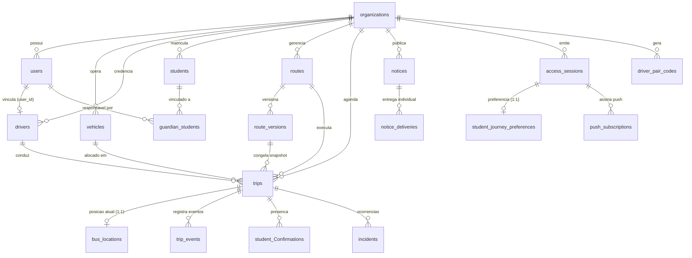

# Banco de Dados e Migrações (`DATABASE.md`)

O **TrackBus** utiliza o **Cloudflare D1** (motor SQLite distribuído na borda) gerenciado pelo **Drizzle ORM** ([`db/schema.ts`](../db/schema.ts) e [`db/index.ts`](../db/index.ts)). O esquema completo é composto por **19 tabelas** e **4 triggers SQLite** de integridade operacional.

---

## 1. Diagrama Entidade-Relacionamento (ER)



---

## 2. Catálogo das 19 Tabelas (`db/schema.ts`)

### 2.1 Núcleo Institucional e Cadastros

| Tabela | Chave Primária | Descrição e Colunas Principais |
| :--- | :--- | :--- |
| `organizations` | `id` (`text`) | Instituição de ensino (`name`, `slug` único, `Safety_margin` padrão `3` min, `demo` boolean, `room_open` boolean para Smart Journey). |
| `users` | `id` (`text`) | Usuários autenticados (`org_id`, `email`, `name`, `role`: `'admin' \| 'driver' \| 'guardian' \| 'student'`, `active`). Índice único em `(org_id, email)`. |
| `vehicles` | `id` (`text`) | Frota escolar (`org_id`, `code` único por org, `plate` única por org, `capacity`, `model`, `accessibility`, `status`: `'active' \| 'maintenance' \| 'inactive'`). |
| `drivers` | `id` (`text`) | Motoristas habilitados (`org_id`, `user_id`, `name`, `email`, `phone`, `license` CNH única por org, `status`: `'active' \| 'off' \| 'suspended'`). |
| `students` | `id` (`text`) | Estudantes cadastrados (`org_id`, `user_id`, `name`, `grade`, `code` matrícula única por org, `route_id`, `stop_id`, `accessibility_notes`, `active`). |
| `guardian_students` | `id` (`text`) | Relação N:N entre usuários (`guardian_user_id` ou próprio aluno) e `student_id`, com `relationship` (`Responsável`, `Estudante`, etc.). |

### 2.2 Rotas, Versionamento e Viagens

| Tabela | Chave Primária | Descrição e Colunas Principais |
| :--- | :--- | :--- |
| `routes` | `id` (`text`) | Linha de transporte (`org_id`, `code`, `name`, `shift`: `'morning' \| 'afternoon' \| 'evening'`, `color`, `active`, `visible_in_journey`, `current_version`). |
| `route_versions` | `id` (`text`) | Histórico imutável de alterações da rota (`route_id`, `version`, `summary`, `stops` JSON `Stop[]`, `geometry` JSON `Point[]`, `distance_meters`, `duration_seconds`, `source`: `'valhalla' \| 'osm-local' \| 'institutional'`). |
| `trips` | `id` (`text`) | Viagem agendada ou ativa (`org_id`, `route_id`, `route_version_id`, `vehicle_id`, `driver_id`, `service_date` `YYYY-MM-DD`, `shift`, `status`: `'scheduled' \| 'active' \| 'paused' \| 'interrupted' \| 'completed' \| 'cancelled'`, `tracking_mode`: `'gps' \| 'simulation'`, `delay_minutes`, `delay_reason`, `delay_until`, `wait_stop_id`, `wait_until`, `current_stop_id`, `snapshot` JSON congelado da rota). |
| `bus_locations` | `trip_id` (`text`) | Última posição conhecida do veículo (`org_id`, `lat`, `lng`, `speed_kmh`, `heading`, `accuracy_m`, `source`: `'gps' \| 'simulation'`, `progress_m`, `next_stop_id`, `eta_seconds`, `stale`, `updated_at`). |
| `trip_events` | `id` (`text`) | Trilha de auditoria da viagem (`trip_id`, `org_id`, `type`, `message`, `actor_id`, `payload` JSON, `created_at`). |
| `student_confirmations` | `id` (`text`) | Confirmação de embarque do estudante por viagem (`trip_id`, `student_id`, `status`: `'going' \| 'not_going'`). Índice único em `(trip_id, student_id)`. |

### 2.3 Ocorrências, Avisos e Notificações

| Tabela | Chave Primária | Descrição e Colunas Principais |
| :--- | :--- | :--- |
| `incidents` | `id` (`text`) | Ocorrências operacionais (`org_id`, `trip_id`, `route_id`, `vehicle_id`, `driver_id`, `severity`: `'low' \| 'medium' \| 'high' \| 'critical'`, `category`: `'delay' \| 'mechanical' \| 'traffic' \| 'stop_change' \| 'cancellation' \| 'safety'`, `title`, `description`, `status`: `'open' \| 'monitoring' \| 'resolved'`). |
| `notices` | `id` (`text`) | Avisos operacionais e institucionais (`org_id`, `route_id`, `trip_id`, `scope`: `'all' \| 'route' \| 'trip'`, `severity`: `'info' \| 'warning' \| 'urgent'`, `kind`: `'delay' \| 'wait' \| 'breakdown' \| 'arrival' \| 'institutional'`, `title`, `message`, `metadata` JSON). |
| `notice_deliveries` | `id` (`text`) | Rastreamento de entrega individual de avisos (`org_id`, `notice_id`, `session_id`, `user_id`, `channel`: `'in_app' \| 'web_push'`, `status`: `'delivered' \| 'push_sent' \| 'push_failed' \| 'read'`, `detail`). |
| `push_subscriptions` | `id` (`text`) | Assinaturas Web Push RFC 8291 (`org_id`, `user_id`, `session_id`, `route_id`, `stop_id`, `endpoint` único, `p256dh`, `auth`, `user_agent`). |

### 2.4 Sessões, Pareamento Mobile e Rate Limiting

| Tabela | Chave Primária | Descrição e Colunas Principais |
| :--- | :--- | :--- |
| `access_sessions` | `id` (`text`) | Sessões V3 (`org_id`, `kind`: `'visitor_student' \| 'driver_device'`, `token_hash` SHA-256 único, `display_name`, `school_name`, `driver_id`, `device_label`, `expires_at`, `revoked_at`). |
| `student_journey_preferences` | `session_id` (`text`) | Seleção ativa do visitante na Smart Journey (`org_id`, `route_id`, `stop_id`, `trip_id`, `walk_meters`, `walk_seconds`, `walk_source`, `updated_at`). |
| `driver_pair_codes` | `id` (`text`) | Códigos temporários de 6 dígitos para pareamento do app Android (`org_id`, `driver_id`, `code_hash` SHA-256 único, `expires_at` 2 min, `used_at`). |
| `demo_sessions` | `id` (`text`) | Sessões demonstrativas da interface web (`org_id`, `actor_user_id`, `student_id`, `expires_at`). |
| `rate_limits` | `key` (`text`) | Janelas de controle de taxa (`count`, `reset_at`). |

---

## 3. Estruturas JSON Armazenadas

Para evitar junções custosas a cada leitura de telemetria em tempo real, o banco armazena estruturas tipadas (validadas via Zod e tipadas via `$type<T>()` no Drizzle):

- **`route_versions.stops` (`Stop[]`)**:
  ```json
  [
    { "id": "stop_1", "name": "Portaria Caetano Moura", "lat": -12.99911, "lng": -38.51153, "order": 1, "scheduledTime": "06:30", "dwellSeconds": 45 }
  ]
  ```
- **`route_versions.geometry` (`Point[]`)**: Polilinha completa da rota gerada pelo motor viário (`osm-local` ou `valhalla`).
- **`trips.snapshot`**: Cópia imutável de `{ routeName, routeCode, color, version, stops, geometry, distanceMeters, durationSeconds }` no momento da criação da viagem. Garante que edições futuras na rota não corrompam viagens em andamento ou concluídas.

---

## 4. Gatilhos SQLite (`Triggers`)

Definidos na migração [`drizzle/0001_guards.sql`](../drizzle/0001_guards.sql):

1. **`trip_schedule_insert` & `trip_schedule_update`**:
   - Disparam `BEFORE INSERT` e `BEFORE UPDATE` na tabela `trips`.
   - Verificam se já existe outra viagem com `status IN ('scheduled', 'active', 'paused', 'interrupted')` na mesma `org_id`, `service_date` e `shift` compartilhando o mesmo `route_id`, `driver_id` ou `vehicle_id`.
   - Caso exista, abortam a transação com `RAISE(ABORT, 'Conflito de agenda para rota, motorista ou veiculo')`.
2. **`trackbus_location_insert` & `trackbus_location_update`**:
   - Disparam `BEFORE INSERT` e `BEFORE UPDATE` na tabela `bus_locations`.
   - Comparam `NEW.source` (`'gps'` ou `'simulation'`) com `trips.tracking_mode` da viagem correspondente.
   - Se divergirem, abortam com `RAISE(ABORT, 'Fonte de localizacao incompativel com o modo de rastreamento da viagem')`.

---

## 5. Histórico de Migrações (`drizzle/`)

As migrações SQL ficam em [`drizzle/`](../drizzle/) e são aplicadas automaticamente em ambiente local pelo script [`scripts/migrate-local.mjs`](../scripts/migrate-local.mjs) (`npm run db:migrate:local`) ou em testes de integração ([`tests/integration/api.test.ts`](../tests/integration/api.test.ts)):

| Arquivo | Escopo da Migração |
| :--- | :--- |
| [`0000_wet_chat.sql`](../drizzle/0000_wet_chat.sql) | Criação das 14 tabelas originais (`organizations`, `users`, `vehicles`, `drivers`, `students`, `guardian_students`, `routes`, `route_versions`, `trips`, `bus_locations`, `trip_events`, `student_confirmations`, `incidents`, `notices`, `demo_sessions`, `rate_limits`) e seus índices. |
| [`0001_guards.sql`](../drizzle/0001_guards.sql) | Criação dos 4 gatilhos SQLite (`trip_schedule_insert`, `trip_schedule_update`, `trackbus_location_insert`, `trackbus_location_update`). |
| [`0002_smart_journey.sql`](../drizzle/0002_smart_journey.sql) | Expansão V3: colunas `room_open` em `organizations`, `visible_in_journey` em `routes`, `delay_until`/`wait_stop_id`/`wait_until` em `trips`, `kind`/`metadata` em `notices`, e criação das tabelas `access_sessions`, `student_journey_preferences`, `driver_pair_codes` e `push_subscriptions`. |
| [`0003_notice_delivery.sql`](../drizzle/0003_notice_delivery.sql) | Criação da tabela `notice_deliveries` e índices de entrega por aviso e sessão. |
