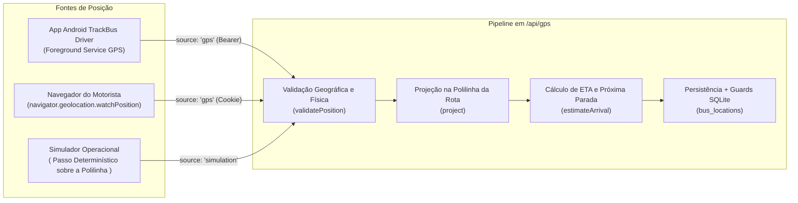

# Rastreamento GPS e Simulação (`GPS.md`)

O módulo de rastreamento do **TrackBus** suporta duas fontes estritamente isoladas de posicionamento veicular — **GPS Real** (`source: 'gps'`) e **Simulação Controlada** (`source: 'simulation'`) — unificadas por um pipeline determinístico de validação, projeção linear em polilinha e interpolação suave no mapa.

---

## 1. Separação Estrita: GPS Real vs. Simulação

Cada viagem (`trips`) possui a propriedade `tracking_mode` (`'gps'` ou `'simulation'`), visível em todos os cartões da interface com selos distintos (**GPS real** vs. **Simulação**).

A separação é garantida em **duas camadas independentes**:
1. **Camada de Domínio/API** ([`apps/api/index.ts`](../apps/api/index.ts)): O endpoint `POST /api/gps` verifica `if (trip.trackingMode !== body.source)` e rejeita com `409 Viagem configurada para <modo>; fonte recebida: <fonte>`.
2. **Camada de Banco de Dados** ([`drizzle/0001_guards.sql`](../drizzle/0001_guards.sql)): Os gatilhos SQLite `trackbus_location_insert` e `trackbus_location_update` abortam qualquer `INSERT` ou `UPDATE` em `bus_locations` cuja coluna `source` seja diferente de `trips.tracking_mode`.

Isso garante que o simulador da feira jamais sobrescreva a posição de um ônibus rastreado por celular real, e vice-versa.

---

## 2. Fontes de Telemetria suportadas

### 2.1 Aplicativo Android (`apps/driver`)
- Utiliza `expo-location` + `expo-task-manager` com serviço em primeiro plano (`foregroundService`) no Android ([`apps/driver/tracking.ts`](../apps/driver/tracking.ts)).
- Configurado com `Accuracy.High`, `timeInterval: 4000` (4 segundos) e `distanceInterval: 8` (8 metros).
- Continua transmitindo coordenadas mesmo com a tela bloqueada ou o aplicativo em segundo plano.
- Possui fila local resiliente (`SecureStore`): se a conexão oscilar na feira, até 20 posições recentes são retidas e reenviadas assim que a rede responde.

### 2.2 Navegador Web (`apps/web/App.tsx` e `apps/web/DemoControls.tsx`)
- Na tela do motorista (`/driver`) ou na barra de demonstração (para viagens em modo `gps`), o navegador utiliza `navigator.geolocation.watchPosition` com `enableHighAccuracy: true`.

### 2.3 Simulador Determinístico
- Para viagens com `trackingMode === 'simulation'`, o operador pode acionar o simulador passo a passo ou contínuo (a cada `2.4s`), que percorre os vértices da geometria real da rota a `28 km/h`, permitindo demonstrar curvas, aproximação de paradas e recálculo de ETA mesmo dentro de um auditório fechado sem sinal de satélites.

---

## 3. Regras de Validação de Telemetria (`validatePosition`)

Implementadas em [`packages/domain/index.ts`](../packages/domain/index.ts):

1. **Limites Geográficos**: `lat` em `[-90, 90]` e `lng` em `[-180, 180]` (números finitos).
2. **Precisão Mínima (`accuracyM`)**: Leituras com imprecisão reportada superior a **1.500 metros** são descartadas (`Precisao GPS insuficiente`).
3. **Velocidade Informada**: Valores negativos ou superiores a **130 km/h** são rejeitados como ruído de sensor (`Velocidade fora do intervalo operacional`).
4. **Filtro Anti-Teletransporte (Velocidade Implícita)**:
   - Quando há uma posição anterior registrada há mais de `3 segundos` da mesma fonte (`prev.source === next.source`), o sistema calcula a distância Haversine $\Delta d$ e o intervalo de tempo $\Delta t$.
   - Se $\Delta d > 500\text{ m}$ e a velocidade implícita superar **140 km/h**, a leitura é rejeitada com `Salto geografico incompativel com deslocamento real`.
5. **Estimativa Automática de Velocidade**: Caso o dispositivo móvel omita `speedKmh` (comum em alguns chipsets GPS em baixa velocidade), o backend estima a velocidade a partir de $\Delta d / \Delta t$ limitada à faixa operacional `[8, 60] km/h` (ou `24 km/h` na primeira leitura).

---

## 4. Detecção de Sinal Desatualizado (`Stale Signal`)

A função [`isStale`](../packages/domain/index.ts) avalia a idade do timestamp `updatedAt` de cada registro em `bus_locations`:
- **Sinal Vivo (`stale: false`)**: atualização recebida nos últimos **60 segundos**.
- **Sinal Desatualizado (`stale: true`)**: sem atualização há mais de **60 segundos**.
- Quando `stale` torna-se verdadeiro, o painel operacional, o portal do responsável e a Smart Journey exibem um alerta visual claro informando a idade da última leitura, sem inventar ou extrapolar movimento.

---

## 5. Interpolação Visual no Mapa (`apps/web/Map.tsx`)

Para evitar que o marcador do ônibus "pule" bruscamente entre atualizações de 4 segundos:
- O componente [`MapView`](../apps/web/Map.tsx) armazena a posição anterior e a nova posição recebida em `prevRef`.
- Um loop `requestAnimationFrame` interpola linearmente (`ease`) entre a coordenada anterior confirmada e a nova coordenada confirmada ao longo de até `1.100 ms` (para deslocamentos curtos `< 350 m`).
- **Sem Extrapolação Fictícia**: O marcador nunca avança além da última coordenada efetivamente confirmada pelo backend. Se o ônibus parar ou perder sinal, o marcador permanece exatamente na última posição real conhecida.
