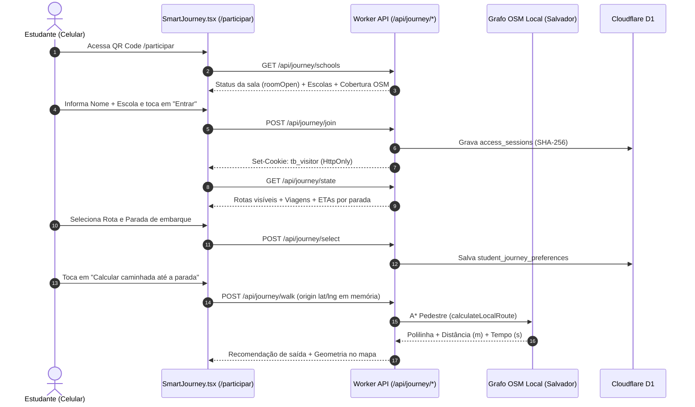

# Smart Journey e Cálculo de Chegada (`SMART_JOURNEY.md`)

A **Smart Journey** ([`apps/web/SmartJourney.tsx`](../apps/web/SmartJourney.tsx) e [`apps/api/journey.ts`](../apps/api/journey.ts)) é a experiência móvel voltada aos estudantes — tanto no portal institucional quanto na sala pública demonstrativa `/participar` durante a **FECT** e a **Congretech**. Seu objetivo é responder em tempo real: **onde está o ônibus, em quantos minutos ele chega à minha parada e quando devo sair a pé de onde estou**.

---

## 1. Fluxo do Estudante Visitante (`/participar`)

---

## 2. Projeção Linear na Rota e Cálculo de ETA

Toda vez que o ônibus envia uma coordenada (`/api/gps`) ou o estado da jornada é consultado (`GET /api/journey/state`), o módulo [`packages/domain/index.ts`](../packages/domain/index.ts) executa:

### 2.1 Projeção Ortogonal em Polilinha (`project`)
- Converte cada segmento da polilinha da rota (`geometry`) para coordenadas planas locais (aproximação equiretangular centrada na latitude média da rota).
- Projeta a posição `(lat, lng)` do veículo sobre o segmento mais próximo, obtendo a **distância acumulada percorrida desde o início da rota (`progressMeters`)** e a distância perpendicular até a via (`distanceToRouteMeters`).

### 2.2 Estimativa de Chegada por Parada (`estimateArrival` e `computeStopEtas`)
Para cada parada $i$ da rota:
1. Calcula-se a posição da parada ao longo da polilinha ($d_{\text{stop}, i}$).
2. Se $d_{\text{stop}, i} \le \text{progressMeters} + 20\text{ m}$, a parada é marcada como **`passed: true`** (ônibus já passou ou encontra-se nela).
3. Para as paradas à frente ($d_{\text{stop}, i} > \text{progressMeters}$):
   - Distância restante na rota:
     $$\Delta d_i = d_{\text{stop}, i} - \text{progressMeters}$$
   - Velocidade efetiva $v_{\text{mps}}$: velocidade atual do veículo limitada à faixa operacional $[3{,}5\text{ m/s},\ 16{,}5\text{ m/s}]$ (aprox. $12{,}6\text{ km/h}$ a $59{,}4\text{ km/h}$).
   - Soma dos tempos de embarque (`dwellSeconds`) das paradas intermediárias ainda não visitadas:
     $$T_{\text{dwell}, i} = \sum_{k \text{ entre ônibus e } i} \text{dwellSeconds}_k$$
   - Espera autorizada ativa na parada (`waitUntil`):
     $$T_{\text{wait}} = \max\left(0,\ \frac{\text{waitUntil} - t_{\text{agora}}}{1000}\right)$$
   - Atraso operacional reportado pelo motorista (`delayMinutes` enquanto `delayUntil` estiver vigente):
     $$T_{\text{delay}} = \text{delayMinutes} \times 60$$
   - **ETA Total em Segundos**:
     $$\text{ETA}_{\text{seg}, i} = \text{round}\left(\frac{\Delta d_i}{v_{\text{mps}}} + T_{\text{dwell}, i} + T_{\text{wait}} + T_{\text{delay}}\right)$$

---

## 3. Cálculo da Rota de Caminhada (`packages/geodata`)

Quando o estudante compartilha sua localização no navegador para calcular o trajeto a pé até a parada selecionada:

1. **Motor Primário — Grafo Local OpenStreetMap de Salvador (`source: 'osm-local'`)**:
   - Implementado em [`packages/geodata/index.ts`](../packages/geodata/index.ts) sobre o recorte viário real [`packages/geodata/salvador.json`](../packages/geodata/salvador.json) (26.006 nós e 27.651 arestas cobrindo a Federação, Rua Caetano Moura, Engenho Velho da Federação, Rio Vermelho, Ondina, Barra, Graça, Canela e entorno).
   - No modo `'pedestrian'`, o algoritmo **A\*** considera calçadas, vias de pedestres (`footway`, `pedestrian`, `path`, `steps`, `living_street`) e vias urbanas permitidas (`w !== 0`), ignorando restrições de mão única exclusivas para veículos motorizados e adotando velocidade média de caminhada de **$1{,}3\text{ m/s}$ ($4{,}68\text{ km/h}$)**.
2. **Motor Secundário — Valhalla (`source: 'valhalla'`)**:
   - Caso a coordenada esteja fora do polígono de Salvador e `VALHALLA_URL` esteja configurada no ambiente, consulta o motor Valhalla com `costing: 'pedestrian'`.
3. **Contingência Determinística (`source: 'institutional'`)**:
   - Se a coordenada estiver fora da área coberta pelo grafo local e sem serviço externo configurado, estima a distância de caminhada aplicando um fator urbano de sinuosidade ($1{,}22 \times d_{\text{Haversine}}$) a $75\text{ m/min}$ ($4{,}5\text{ km/h}$).

---

## 4. Recomendação Inteligente de Saída (`walkingRecommendation`)

Com o tempo até a chegada do ônibus ($\text{etaMinutes}$) e o tempo de caminhada a pé ($\text{walkingMinutes}$), além da margem de segurança configurada pela instituição ($\text{safetyMargin}$, padrão **3 minutos**), a função [`walkingRecommendation`](../packages/domain/index.ts) calcula:

$$\text{leaveInMinutes} = \text{round}(\text{etaMinutes} - \text{walkingMinutes} - \text{safetyMargin})$$

| Condição | Status Retornado | Recomendação Exibida ao Estudante |
| :--- | :--- | :--- |
| $\text{etaMinutes} < \text{walkingMinutes}$ | `late_risk` (Vermelho/Alerta) | **Risco de perder o embarque**: o tempo a pé supera a previsão atual de chegada do ônibus. |
| $\text{leaveInMinutes} \le 1$ | `leave_now` (Amarelo Destaque) | **Saia agora**: deslocamento imediato recomendado para chegar com margem de segurança. |
| $\text{leaveInMinutes} > 1$ | `wait` (Estável) | **Saia em $N$ min**: aguarde em local seguro e inicie a caminhada no horário indicado. |

---

## 5. Diretrizes de Segurança Viária e Privacidade na Interface

A tela da Smart Journey exibe avisos permanentes de proteção ao estudante:
- **Orientação de Travessia**: *"Caminhe pela calçada, atravesse apenas na faixa ou passarela e nunca corra para alcançar o ônibus."*
- **Atribuição Cartográfica**: Quando a rota utiliza a malha local (`source: 'osm-local'`), a interface exibe a atribuição obrigatória `Dados viários: © OpenStreetMap contributors (ODbL)`.
- **Privacidade Efêmera**: A posição GPS do celular do estudante é usada apenas para desenhar a linha tracejada amarela no mapa do próprio aparelho e calcular o tempo de caminhada em memória; nunca é salva no banco de dados nem compartilhada com outros usuários.
